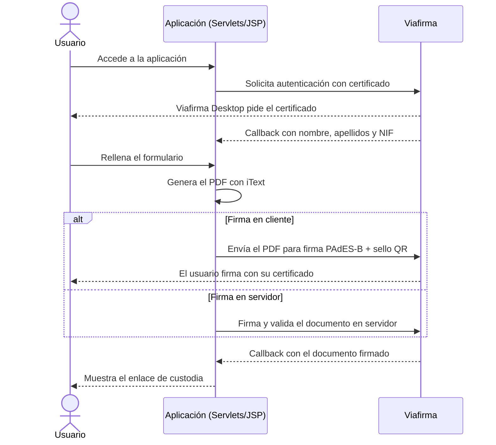

# Certificado Electrónico · Firma digital con Viafirma

[](https://github.com/Euchelu/certificado-electronico/actions/workflows/ci.yml)


Aplicación web Java EE que autentica al usuario con su **certificado digital** y le permite **firmar electrónicamente** un documento PDF a través de la plataforma **Viafirma**. Desarrollada para la asignatura de Administración Electrónica del Grado en Ingeniería Informática en Sistemas de Información (Universidad Pablo de Olavide, curso 24/25).

## Qué hace

- **Autenticación con certificado X.509** a través de Viafirma Desktop: obtiene nombre, apellidos y NIF del titular.
- **Generación del documento** con iText 7: formulario en PDF con los datos del certificado y metadatos del documento.
- **Firma en cliente (PAdES-B)** con el certificado del usuario y **sello QR** de Viafirma como prueba visual verificable.
- **Firma en servidor** como alternativa, con **validación inmediata** del documento firmado mediante la API de validación de Viafirma.
- **Custodia:** enlace al documento firmado y custodiado por Viafirma.

## Flujo



| Paso | Componente |
|---|---|
| Inicio de la autenticación | `servlet.java` |
| Callback de autenticación (datos del certificado en sesión) | `servlet2.java` |
| Formulario | `jsp2.jsp` |
| Generación del PDF y firma en cliente | `PdfCreator.java`, `FirmaDocumentoServlet.java` |
| Firma en servidor con validación inmediata | `FirmaServidorServlet.java` |
| Resultado y enlace de custodia | `servlet3.java`, `jspResultadoServidor.jsp` |

## Estructura

```
src/main/java/
├── servlets/
│   ├── Constantes.java              # Lee las credenciales de Viafirma del entorno
│   ├── PdfCreator.java              # Generación del PDF con iText
│   ├── servlet.java                 # Inicio de autenticación
│   ├── servlet2.java                # Callback de autenticación
│   ├── servlet3.java                # Callback de firma en cliente
│   ├── FirmaDocumentoServlet.java   # Firma PAdES-B en cliente
│   ├── FirmaServidorServlet.java    # Firma en servidor + validación
│   └── CerrarSesion.java
└── org/openapitools/client/         # Cliente de la API de Viafirma (generado con OpenAPI)

src/main/webapp/                     # Vistas JSP, estilos y web.xml
src/test/java/servlets/              # Tests JUnit 5
```

## Requisitos

- Java 8 o superior (probado en CI con Java 11 y 17)
- Maven 3.x
- Tomcat 7/9 o equivalente
- Credenciales de acceso a la plataforma Viafirma

## Configuración

Las credenciales de Viafirma **no se guardan en el código**. Se leen de variables de entorno o, si no existen, de propiedades de sistema de la JVM:

| Variable | Descripción |
|---|---|
| `VIAFIRMA_USERNAME` | Usuario de la API de Viafirma |
| `VIAFIRMA_PASSWORD` | Contraseña de la API de Viafirma |

```bash
export VIAFIRMA_USERNAME="tu-usuario"
export VIAFIRMA_PASSWORD="tu-contraseña"
```

En Tomcat también puedes definirlas en `setenv.sh` con `-DVIAFIRMA_USERNAME=... -DVIAFIRMA_PASSWORD=...`.

## Compilar y desplegar

```bash
mvn clean package        # Compila, ejecuta los tests y genera el WAR en target/
mvn tomcat7:run          # O arranca directamente con el plugin de Tomcat
```

La aplicación arranca en `http://localhost:8080/CeballosRodriguezJoseAngel`.

## Tests

```bash
mvn test
```

Los tests comprueban que el PDF generado es válido y contiene los datos del solicitante, el consentimiento, la sección opcional de localización y los valores por defecto cuando faltan datos, además de la lectura de credenciales desde el entorno. GitHub Actions los ejecuta con Java 11 y 17 en cada *push* y *pull request*, y guarda el WAR generado como artefacto.

## Tecnologías

Java EE 7 · Servlets · JSP · JSTL · Maven · Tomcat · iText 7 · BouncyCastle · API REST de Viafirma (cliente OpenAPI) · JUnit 5 · GitHub Actions

## Autor

**José Ángel Ceballos Rodríguez** · [Portfolio](https://euchelu.github.io/portfolio/) · [GitHub](https://github.com/Euchelu)
